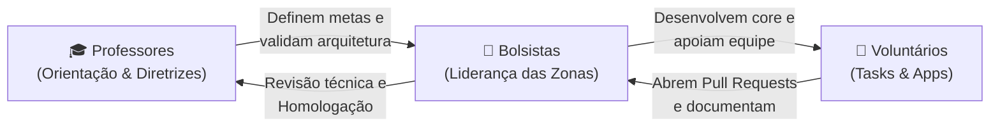

# 🏛️ Estrutura de Cargos e Governança — ROBOLDO (LAR / UERN)

Este documento define os **cargos**, responsabilidades, permissões no GitHub e fluxo de trabalho dos membros da organização **[ROBOLDO-UERN](https://github.com/ROBOLDO-UERN)** no **Laboratório de Automação e Robótica (LAR / UERN)**.

---

## 👥 Quadro de Cargos do Projeto

Os integrantes do ecossistema **Roboldo** estão organizados em três cargos principais, refletidos nas **Equipes (Teams)** da organização e nas **Labels de Cargo** das Issues:

| Cargo | Team no GitHub | Label nas Issues | Permissão nos Repositórios | Papel Principal |
| :--- | :--- | :--- | :--- | :--- |
| 🎓 **Professores** | `@ROBOLDO-UERN/professores` | [`cargo: professor`](https://github.com/ROBOLDO-UERN/Roboldo-Base/issues?q=label%3A%22cargo%3A+professor%22) | `Admin` / `Maintain` | Coordenação geral, orientação científica e técnica, validação arquitetural e aprovação final de entregas/releases. |
| 🔬 **Bolsistas** | `@ROBOLDO-UERN/bolsistas` | [`cargo: bolsista`](https://github.com/ROBOLDO-UERN/Roboldo-Base/issues?q=label%3A%22cargo%3A+bolsista%22) | `Write` (`Push`) | Desenvolvimento contínuo, liderança técnica das **Zonas de Projetos**, cumprimento de metas do plano de trabalho, revisão de código de voluntários e documentação. |
| 🤝 **Voluntários** | `@ROBOLDO-UERN/voluntarios` | [`cargo: voluntario`](https://github.com/ROBOLDO-UERN/Roboldo-Base/issues?q=label%3A%22cargo%3A+voluntario%22) | `Triage` / `Write` | Colaboração ativa em tasks específicas das Zonas, desenvolvimento de features/apps, modelagem, testes em bancada e documentação. |

---

## 📋 Atribuições Detalhadas por Cargo

### 1. 🎓 Professores (Orientadores & Coordenadores)
- Definir diretrizes de pesquisa, prioridades acadêmicas e cronograma macro do projeto Roboldo.
- Orientar Bolsistas e Voluntários em suas respectivas **Zonas de Projetos** (*SLAM*, *Voz*, *IA*, *Mecânica/Hardware* e *Gamificação/Apps*).
- Revisar e aprovar decisões críticas de arquitetura, segurança física do robô e publicações científicas.
- Gerenciar permissões da organização e homologar versões estáveis (`releases`).

### 2. 🔬 Bolsistas (Pesquisadores & Desenvolvedores Dedicados)
- Assumir responsabilidade direta pelos entregáveis (Issues/Milestones) de sua **Zona de Projeto** (marcados com `cargo: bolsista`).
- Manter a regularidade de commits, documentação técnica e relatórios de progresso no repositório.
- Apoiar a integração e revisão de Pull Requests enviados por Voluntários na sua Zona.
- Garantir que o código e o hardware testados em laboratório sigam os padrões do `Roboldo SDK` e segurança elétrica/mecânica.

### 3. 🤝 Voluntários (Colaboradores de Pesquisa & Desenvolvimento)
- Escolher ou receber atribuição de tasks nas Zonas de Projeto (especialmente aquelas marcadas com `cargo: voluntario` ou da sua área de interesse).
- Desenvolver em branches dedicadas (`feat/...`, `fix/...`, `docs/...`) e submeter entregas via **Pull Request**.
- Participar dos testes práticos com o Roboldo no LAR / UERN e contribuir com novos aplicativos para a **Lojinha do Roboldo**.

---

## 🔄 Fluxo de Trabalho entre os Cargos

1. **Atribuição de Task**: Toda Issue no [`Roboldo-Base`](https://github.com/ROBOLDO-UERN/Roboldo-Base/issues) recebe uma **Label de Zona** (ex.: `zona: mecanica-hardware`) e pode receber uma **Label de Cargo** (`cargo: professor`, `cargo: bolsista` ou `cargo: voluntario`), além do responsável em **Assignees**.
2. **Desenvolvimento**: Bolsistas e Voluntários criam branches a partir da branch alvo (`master` ou `ambiente-configuracao`).
3. **Revisão (Pull Request)**:
   - PRs de **Voluntários** podem ser revisados inicialmente por um **Bolsista** da mesma Zona ou diretamente por um **Professor**.
   - PRs estruturais de **Bolsistas** passam por validação da coordenação (**Professores**) ou líder técnico designado.
