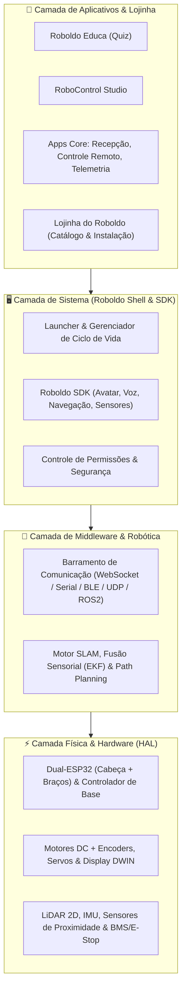

# 🤖 Roboldo Base — Ecossistema do Robô Social Roboldo

[](https://github.com/ROBOLDO-UERN/Roboldo-Base/actions/workflows/roboldo-ci-cd.yml)
[](https://github.com/ROBOLDO-UERN/Roboldo-Base/actions/workflows/robocontrol-studio-ci.yml)
[](https://www.gnu.org/licenses/gpl-3.0)

Bem-vindo ao **Roboldo Base**, o repositório central de software, arquitetura, aplicativos e controle de hardware do **Roboldo** — um robô social interativo desenvolvido no contexto do **Laboratório de Automação e Robótica (LAR / UERN)** voltado para educação, acessibilidade, interação humano-robô (IHR) e navegação autônoma.

---

## 🌟 Visão Geral do Projeto

O **Roboldo** nasceu como uma plataforma robótica social e educacional e está evoluindo para um ecossistema modular completo. O projeto integra:

1. **Roboldo OS / Shell & SDK**: Plataforma em **Flutter** para gerenciamento de ciclo de vida de aplicativos, expressões faciais interativas (`neutro`, `feliz`, `triste`), síntese de voz offline (**Piper TTS**) e telemetria.
2. **Lojinha do Roboldo (App Store)**: Sistema de catálogo e distribuição de aplicativos instaláveis sob demanda no robô, além de utilitários de sistema pré-instalados.
3. **Controle Físico & Hardware (Dual-ESP & Base Móvel)**:
   - Controle articulado da **Cabeça** (com display DWIN e sincronia labial / *lipsync*) e **Braços** via arquitetura Dual-ESP32.
   - Modelagem elétrica, dimensionamento de energia, controle cinemático com malha fechada (PID + encoders) e segurança física (Watchdog, parada de emergência *E-Stop* e *Auto-Docking*).
4. **Mapeamento e Navegação Autônoma (SLAM)**: Pipeline de fusão sensorial (LiDAR 2D, Odometria e IMU), geração de mapas de ocupação (*Occupancy Grid*), gerenciamento de Pontos de Interesse (POIs) e planejamento de trajetória com desvio de obstáculos.

---

## 🌿 Estrutura de Branches e Aplicativos

O repositório organiza os aplicativos e módulos de sistema do ecossistema do Roboldo em branches dedicadas:

| App ID | Nome | Branch | Tipo na Lojinha | Descrição |
| :--- | :--- | :--- | :--- | :--- |
| `roboldo-perguntas-e-respostas` | **Roboldo Educa — Perguntas e Respostas** | `master` | 📦 Instalável | Jogo educacional interativo em Flutter (Multiplataforma/Web) com feedback emocional do avatar e comunicação UDP/BLE com o robô. |
| `roboldo-config` | **Ambiente de Configuração (`RoboControl Studio`)** | `ambiente-configuracao` | ⚙️ Pré-instalado (Sistema) | Painel web local para calibração Dual USB Serial (ESP Cabeça + ESP Braços), síntese de voz offline (Piper TTS), simulador cinemático e sequenciador de coreografias. |

---

## 🏗️ Arquitetura Alvo do Ecossistema

O desenvolvimento do **Roboldo Base** está estruturado em quatro camadas principais:



---

## 🚀 Como Executar

### 1. App Flutter — Roboldo Educa (`master`)

#### Pré-requisitos
- [Flutter SDK](https://docs.flutter.dev/) instalado e configurado.

#### Passos
```bash
# Clonar o repositório
git clone https://github.com/ROBOLDO-UERN/Roboldo-Base.git
cd Roboldo-Base

# Instalar dependências
flutter pub get

# Executar o aplicativo (Web, Desktop ou Android)
flutter run
```

**Principais módulos em `lib/`:**
- `main.dart`: Interface principal, gerenciamento de estados emocionais do avatar (`assets/feliz.png`, `assets/neutro.png`, `assets/triste.png`) e fluxo do jogo.
- `questions.dart`: Banco de perguntas e respostas educativas.
- `udp_helper.dart`: Comunicação via pacotes UDP na rede local com os controladores do Roboldo.
- `bluetooth_helper.dart`: Integração via Bluetooth Low Energy (BLE) com o hardware.

---

### 2. Ambiente de Configuração — RoboControl Studio (`ambiente-configuracao`)

Para utilizar o painel de calibração Dual-ESP, voz Piper TTS offline e sequenciador de coreografias:

```bash
# Alternar para a branch do ambiente de configuração
git checkout ambiente-configuracao

# Instalar dependências Python
pip install -r requirements.txt

# Iniciar o servidor local (porta 3000)
py server.py
# Ou via Node.js:
npm start
```
Em seguida, acesse no navegador (Chrome ou Edge para suporte à **Web Serial API**):
- **Painel Principal Dual-ESP**: `http://127.0.0.1:3000/painel`
- **Painel de Voz**: `http://127.0.0.1:3000/`

---

## 🧭 Zonas de Projetos e Roadmap (Issues)

O trabalho de pesquisa e desenvolvimento do **Roboldo** está estruturado em **5 Zonas de Projetos (Grupos)** organizadas por [Milestones](https://github.com/ROBOLDO-UERN/Roboldo-Base/milestones) e [Labels de Zona](https://github.com/ROBOLDO-UERN/Roboldo-Base/labels):

### 🗺️ [Zona 1: SLAM & Navegação Autônoma](https://github.com/ROBOLDO-UERN/Roboldo-Base/milestone/1) (`zona: slam`)
- [#10](https://github.com/ROBOLDO-UERN/Roboldo-Base/issues/10) Arquitetura de Sensores e Pipeline de Mapeamento (LiDAR / Odometria / IMU)
- [#11](https://github.com/ROBOLDO-UERN/Roboldo-Base/issues/11) Módulo de Mapeamento e Localização (Occupancy Grid / SLAM)
- [#12](https://github.com/ROBOLDO-UERN/Roboldo-Base/issues/12) Visualização de Mapa em Tempo Real e Pontos de Interesse (POIs)
- [#14](https://github.com/ROBOLDO-UERN/Roboldo-Base/issues/14) Planejamento de Trajetória (*Path Planning*) e Desvio de Obstáculos

### 🗣️ [Zona 2: Voz & Expressividade](https://github.com/ROBOLDO-UERN/Roboldo-Base/milestone/2) (`zona: voz`)
- [#18](https://github.com/ROBOLDO-UERN/Roboldo-Base/issues/18) Normalização e Padronização dos Rostos e Expressões Faciais do Roboldo
- [#21](https://github.com/ROBOLDO-UERN/Roboldo-Base/issues/21) Serviço Unificado de Síntese de Voz Offline (Piper TTS), Sincronia Labial (Lipsync) e Feedback Sonoro

### 🧠 [Zona 3: Inteligência Artificial & IHR](https://github.com/ROBOLDO-UERN/Roboldo-Base/milestone/3) (`zona: ia`)
- [#19](https://github.com/ROBOLDO-UERN/Roboldo-Base/issues/19) Módulo de Conversação Natural com IA (STT + LLM + Piper TTS & Expressões)

### ⚙️ [Zona 4: Mecânica, Elétrica & Hardware](https://github.com/ROBOLDO-UERN/Roboldo-Base/milestone/4) (`zona: mecanica-hardware`)
- [#13](https://github.com/ROBOLDO-UERN/Roboldo-Base/issues/13) Modelagem Cinemática, Controle PID de Motores e Odometria Física
- [#15](https://github.com/ROBOLDO-UERN/Roboldo-Base/issues/15) Sistema de Segurança Física, Parada de Emergência e Auto-Docking
- [#16](https://github.com/ROBOLDO-UERN/Roboldo-Base/issues/16) Modelagem Elétrica, Dimensionamento de Energia e Diagrama de Ligações
- [#17](https://github.com/ROBOLDO-UERN/Roboldo-Base/issues/17) Integração e Mapeamento dos Sensores de Toque do Roboldo
- [#20](https://github.com/ROBOLDO-UERN/Roboldo-Base/issues/20) Modelagem CAD 3D, Estrutura Física, Chassi e Suportes de Sensores do Roboldo

### 🎮 [Zona 5: Gamificação, Apps & Lojinha](https://github.com/ROBOLDO-UERN/Roboldo-Base/milestone/5) (`zona: gamificacao-apps`)
- [#1](https://github.com/ROBOLDO-UERN/Roboldo-Base/issues/1) Definição da Arquitetura Modular (Core, HAL, Apps & Cloud)
- [#2](https://github.com/ROBOLDO-UERN/Roboldo-Base/issues/2) Especificação e Implementação do Roboldo SDK
- [#3](https://github.com/ROBOLDO-UERN/Roboldo-Base/issues/3) Gerenciador de Ciclo de Vida e Launcher de Apps (Roboldo Shell)
- [#4](https://github.com/ROBOLDO-UERN/Roboldo-Base/issues/4) Modelagem de Domínio e Banco de Dados da Loja
- [#5](https://github.com/ROBOLDO-UERN/Roboldo-Base/issues/5) Backend / API REST para Catálogo e Distribuição
- [#6](https://github.com/ROBOLDO-UERN/Roboldo-Base/issues/6) Design e Prototipação UI/UX da Loja
- [#7](https://github.com/ROBOLDO-UERN/Roboldo-Base/issues/7) Cliente da Loja no App Flutter
- [#8](https://github.com/ROBOLDO-UERN/Roboldo-Base/issues/8) Refatoração do Game *Perguntas e Respostas* para o padrão do SDK
- [#9](https://github.com/ROBOLDO-UERN/Roboldo-Base/issues/9) Novos Apps Core (Recepção/Boas-vindas, Controle Remoto e Telemetria)
- [#22](https://github.com/ROBOLDO-UERN/Roboldo-Base/issues/22) Ecossistema de Jogos Educativos, Acessibilidade (TEA/CAA) e Dinâmicas Gamificadas no Roboldo

---

## 👥 Cargos e Como Contribuir

A equipe do **Roboldo** é estruturada em três cargos oficiais (veja a documentação completa de governança e atribuições em **[GOVERNANCE.md](./GOVERNANCE.md)**):

| Cargo | Label de Filtro nas Issues | Papel no Projeto |
| :--- | :--- | :--- |
| 🎓 **Professores** | [`cargo: professor`](https://github.com/ROBOLDO-UERN/Roboldo-Base/issues?q=is%3Aopen+label%3A%22cargo%3A+professor%22) | Coordenação, orientação docente, definição de diretrizes e aprovação final. |
| 🔬 **Bolsistas** | [`cargo: bolsista`](https://github.com/ROBOLDO-UERN/Roboldo-Base/issues?q=is%3Aopen+label%3A%22cargo%3A+bolsista%22) | Desenvolvimento dedicado nas Zonas de Projeto, cumprimento de metas e revisão técnica. |
| 🤝 **Voluntários** | [`cargo: voluntario`](https://github.com/ROBOLDO-UERN/Roboldo-Base/issues?q=is%3Aopen+label%3A%22cargo%3A+voluntario%22) | Colaboração em tasks das Zonas, desenvolvimento de apps, modelagem e testes. |

### Fluxo de Contribuição
1. Confira as [Issues abertas](https://github.com/ROBOLDO-UERN/Roboldo-Base/issues) filtrando pela sua **Zona de Projeto** (`zona: ...`) e pelo seu **Cargo** (`cargo: ...`).
2. Crie uma branch para sua feature ou documentação (`git checkout -b feat/nome-da-feature`).
3. Faça commits claros seguindo boas práticas (`git commit -m "feat(modulo): descrição da mudança"`).
4. Envie sua branch (`git push origin feat/nome-da-feature`) e abra um **Pull Request**.

---

## 🏛️ Créditos

Projeto desenvolvido junto ao **Laboratório de Automação e Robótica (LAR)** — **Universidade do Estado do Rio Grande do Norte (UERN)**.

---

## 📄 Licença

Este projeto é distribuído sob a licença **GNU General Public License v3.0 (GPL-3.0)**. Isso garante que o ecossistema do **Roboldo** e quaisquer trabalhos derivados permaneçam livres e de código aberto. Veja o arquivo [LICENSE](./LICENSE) para o texto completo.
